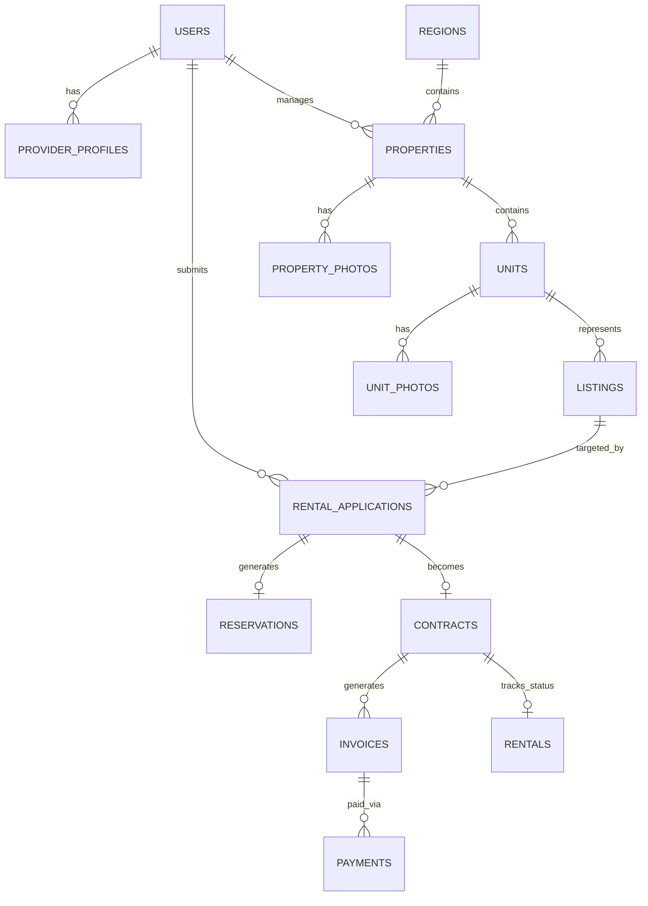

# Database & ERD Blueprint — Platform Kos / Kontrakan / Rumah Sewa

**Version:** v0.1
**Status:** Draft
**Tanggal:** 2026-10-07
**Source:** Architecture Blueprint v0.1, PRD Blueprint v0.1

---

## 1. Konvensi Penamaan (Naming Conventions)
Dalam merancang skema database MySQL ini, kita akan menggunakan konvensi berikut:
- **Tabel**: `snake_case` dan berbentuk jamak (plural), contoh: `users`, `properties`.
- **Kolom**: `snake_case`, contoh: `first_name`, `created_at`.
- **Primary Key**: `id` (Auto-increment `BIGINT UNSIGNED` atau `UUID`).
- **Foreign Key**: `[nama_tabel_singular]_id`, contoh: `user_id`, `property_id`.
- **Timestamp**: Semua tabel utama memiliki kolom `created_at` dan `updated_at`.

---

## 2. Entity-Relationship Diagram (ERD) High-Level

Berikut adalah gambaran relasi antar entitas utama menggunakan Mermaid diagram.

---

## 3. Skema Tabel Detail

### 3.1. Identity & Access Management (IAM)

#### `users`
Tabel utama untuk semua entitas pengguna.
| Column | Type | Constraints | Description |
|---|---|---|---|
| `id` | BIGINT | PK, Auto Increment | |
| `name` | VARCHAR(255) | NOT NULL | Nama lengkap |
| `email` | VARCHAR(255) | UNIQUE, NOT NULL | |
| `password` | VARCHAR(255) | NOT NULL | Hash password (Bcrypt via CI4) |
| `whatsapp` | VARCHAR(20) | NULL | Nomor WhatsApp |
| `gender` | ENUM | NULL | `L` (Laki-laki), `P` (Perempuan) - Wajib untuk Syariat Compliance |
| `role` | ENUM | NOT NULL | `tenant`, `provider`, `admin_daerah`, `super_admin` |
| `status` | ENUM | NOT NULL | `active`, `suspended`, `inactive` |
| `created_at` | TIMESTAMP | | |
| `updated_at` | TIMESTAMP | | |

#### `provider_profiles`
Ekstensi profil khusus untuk role `provider`.
| Column | Type | Constraints | Description |
|---|---|---|---|
| `id` | BIGINT | PK, Auto Increment | |
| `user_id` | BIGINT | FK (users.id) | |
| `verification_status` | ENUM | NOT NULL | `pending`, `verified`, `rejected`, `suspended` |
| `rejection_reason` | TEXT | NULL | |
| `id_card_photo` | VARCHAR(255) | NULL | URL KTP/Identitas |
| `bank_name` | VARCHAR(100) | NULL | Untuk settlement |
| `bank_account_number`| VARCHAR(100) | NULL | |
| `free_period_end` | DATE | NULL | 30 hari gratis atau s.d sewa pertama lunas |

---

### 3.2. Region & Property Management

#### `regions`
Struktur wilayah operasional (Provinsi, Kota/Kab).
| Column | Type | Constraints | Description |
|---|---|---|---|
| `id` | BIGINT | PK, Auto Increment | |
| `parent_id` | BIGINT | FK (regions.id), NULL | Relasi hierarki |
| `name` | VARCHAR(255) | NOT NULL | |
| `level` | ENUM | NOT NULL | `province`, `city`, `operational` |

#### `properties`
Data bangunan/lokasi (misal: Kos Melati).
| Column | Type | Constraints | Description |
|---|---|---|---|
| `id` | BIGINT | PK, Auto Increment | |
| `provider_id` | BIGINT | FK (users.id) | |
| `region_id` | BIGINT | FK (regions.id) | |
| `name` | VARCHAR(255) | NOT NULL | |
| `type` | ENUM | NOT NULL | `kos`, `kontrakan`, `rumah_sewa`, `lainnya` |
| `target_gender` | ENUM | NOT NULL | `putra`, `putri`, `campur_keluarga` (Syarat: Pasutri/Keluarga) |
| `description` | TEXT | NULL | |
| `address` | TEXT | NOT NULL | |
| `latitude` | DECIMAL(10,8)| NULL | Koordinat Peta |
| `longitude` | DECIMAL(11,8)| NULL | Koordinat Peta |
| `rules` | TEXT | NULL | Peraturan umum properti |

#### `property_photos` & `property_facilities`
*(Tabel relasi One-to-Many sederhana ke tabel `properties` untuk menampung link URL foto dan nama/ID fasilitas umum).*

---

### 3.3. Unit & Listing Management

#### `units`
Data fisik kamar/rumah yang disewakan.
| Column | Type | Constraints | Description |
|---|---|---|---|
| `id` | BIGINT | PK, Auto Increment | |
| `property_id` | BIGINT | FK (properties.id) | |
| `name` | VARCHAR(100) | NOT NULL | Contoh: Kamar 01 |
| `size` | VARCHAR(50) | NULL | Ukuran (misal: 3x4 meter) |
| `floor` | VARCHAR(50) | NULL | Lantai ke- |
| `status` | ENUM | NOT NULL | `available`, `reserved`, `occupied`, `maintenance`, `inactive` |

#### `listings`
Representasi unit yang di-publish ke marketplace.
| Column | Type | Constraints | Description |
|---|---|---|---|
| `id` | BIGINT | PK, Auto Increment | |
| `unit_id` | BIGINT | FK (units.id), UNIQUE | 1 Unit = 1 Listing |
| `title` | VARCHAR(255) | NOT NULL | Judul iklan |
| `description` | TEXT | NOT NULL | Deskripsi iklan |
| `price_monthly` | DECIMAL(15,2)| NULL | Harga per bulan |
| `price_yearly` | DECIMAL(15,2)| NULL | Harga per tahun (sediakan juga weekly/daily jika perlu) |
| `publication_status` | ENUM | NOT NULL | `draft`, `pending_review`, `published`, `inactive` |
| `rejection_reason` | TEXT | NULL | Jika ditolak oleh Admin |

---

### 3.4. Transaction & Booking Engine

#### `rental_applications`
Pengajuan sewa dari tenant ke provider.
| Column | Type | Constraints | Description |
|---|---|---|---|
| `id` | BIGINT | PK, Auto Increment | |
| `tenant_id` | BIGINT | FK (users.id) | |
| `listing_id` | BIGINT | FK (listings.id) | |
| `unit_id` | BIGINT | FK (units.id) | |
| `start_date` | DATE | NOT NULL | |
| `duration_months` | INT | NOT NULL | Lama sewa |
| `payment_schedule`| ENUM | NOT NULL | `full_upfront`, `monthly`, `3_monthly` dll |
| `rental_amount` | DECIMAL(15,2)| NOT NULL | Harga yang disetujui di awal |
| `status` | ENUM | NOT NULL | `pending`, `approved`, `rejected`, `cancelled`, `expired` |
| `rejection_reason`| TEXT | NULL | |

#### `reservations`
Locking unit setelah Provider menyetujui pengajuan.
| Column | Type | Constraints | Description |
|---|---|---|---|
| `id` | BIGINT | PK, Auto Increment | |
| `application_id` | BIGINT | FK (rental_applications.id) | |
| `expires_at` | DATETIME | NOT NULL | Batas waktu pembayaran checkout |
| `status` | ENUM | NOT NULL | `active`, `converted`, `expired`, `cancelled` |

---

### 3.5. Contract, Billing & Payments

#### `contracts`
Snapshot dokumen/kesepakatan saat pembayaran pertama berhasil.
| Column | Type | Constraints | Description |
|---|---|---|---|
| `id` | BIGINT | PK, Auto Increment | |
| `application_id` | BIGINT | FK (rental_applications.id) | |
| `tenant_id` | BIGINT | FK (users.id) | |
| `provider_id` | BIGINT | FK (users.id) | |
| `property_id` | BIGINT | FK (properties.id) | |
| `unit_id` | BIGINT | FK (units.id) | |
| `start_date` | DATE | NOT NULL | |
| `end_date` | DATE | NOT NULL | |
| `agreed_price` | DECIMAL(15,2)| NOT NULL | Snapshot harga |
| `payment_schedule`| ENUM | NOT NULL | |
| `status` | ENUM | NOT NULL | `active`, `completed`, `terminated` |

#### `invoices`
Tagihan bulanan / per termin yang harus dibayar PENYEWA.
| Column | Type | Constraints | Description |
|---|---|---|---|
| `id` | BIGINT | PK, Auto Increment | |
| `contract_id` | BIGINT | FK (contracts.id) | |
| `tenant_id` | BIGINT | FK (users.id) | |
| `rental_amount` | DECIMAL(15,2)| NOT NULL | Bagian untuk Provider |
| `gateway_fee` | DECIMAL(15,2)| NOT NULL | Bagian untuk Payment Gateway/Platform |
| `total_amount` | DECIMAL(15,2)| NOT NULL | Yang harus dibayar Tenant |
| `due_date` | DATE | NOT NULL | Tanggal jatuh tempo |
| `status` | ENUM | NOT NULL | `upcoming`, `pending`, `paid`, `overdue`, `cancelled` |

#### `payments`
Rekaman aktual transaksi dari Payment Gateway.
| Column | Type | Constraints | Description |
|---|---|---|---|
| `id` | BIGINT | PK, Auto Increment | |
| `invoice_id` | BIGINT | FK (invoices.id) | |
| `amount_paid` | DECIMAL(15,2)| NOT NULL | |
| `gateway_trx_id`| VARCHAR(255) | NULL | ID Transaksi dari Payment Gateway |
| `payment_method`| VARCHAR(100) | NULL | misal: `bank_transfer`, `ewallet` |
| `status` | ENUM | NOT NULL | `pending`, `success`, `failed`, `refunded` |
| `paid_at` | DATETIME | NULL | |

---

### 3.6. Audit & Logs (Untuk Keamanan & Resolusi Konflik)

#### `audit_logs`
Tabel Append-Only untuk mencatat aktivitas penting (Moderasi, Status Finansial).
| Column | Type | Constraints | Description |
|---|---|---|---|
| `id` | BIGINT | PK, Auto Increment | |
| `actor_id` | BIGINT | FK (users.id), NULL | NULL jika dari sistem (Cron Job) |
| `action` | VARCHAR(100) | NOT NULL | Contoh: `APPROVE_LISTING` |
| `object_type` | VARCHAR(100) | NOT NULL | Contoh: `listings` |
| `object_id` | BIGINT | NOT NULL | ID objek yang diubah |
| `previous_state`| JSON | NULL | Snapshot state lama |
| `new_state` | JSON | NULL | Snapshot state baru |
| `reason` | TEXT | NULL | Alasan perubahan (wajib jika ditolak) |
| `created_at` | TIMESTAMP | | |

---

## 4. Kesimpulan Desain
Skema ERD ini menggunakan pendekatan relasional murni (RDBMS) yang sangat cocok dijalankan di **MySQL**. Fitur bawaan CodeIgniter 4 seperti *Database Forge*, *Migrations*, dan *Seeders* dapat dengan mudah membangun dan mengelola skema ini. Indeks (*Indexing*) akan ditambahkan pada kolom `region_id`, `status`, dan `due_date` untuk menunjang pencarian dan proses *Cron Jobs* agar performa stabil di *shared hosting*.
