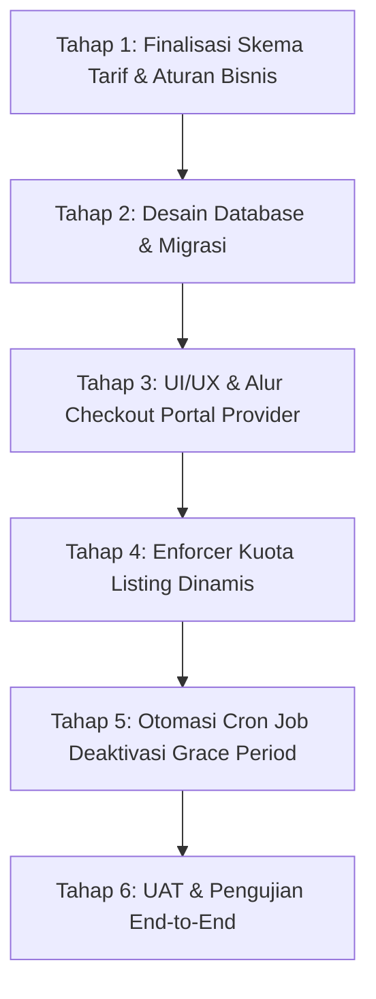

# Rencana Implementasi: Modul Billing & Subscription Provider (KosAja)

*Dokumen ini merupakan rangkuman hasil diskusi, analisis gap PRD, dan peta jalan (roadmap) pengembangan Modul Billing Provider KosAja.*

---

## 1. Latar Belakang & Analisis Masalah

### 1.1. Klausul PRD Blueprint
Pada dokumen [3. PRD_Blueprint_v0.1.md](3.%20PRD_Blueprint_v0.1.md), Bagian 29 (*Provider Monetization*), tercantum aturan:
> **FR-PM-004:**  
> *"Ketika Free Period berakhir akibat transaksi sewa pertama berhasil, sistem memberikan masa transisi (Grace Period 3 hari) bagi provider untuk memilih paket Listing Fee / Subscription sebelum sisa unit listing yang belum tersewa dinonaktifkan dari marketplace."*

### 1.2. Kondisi Riil Sistem Saat Ini
1. **Belum Ada Modul Billing Mandiri (*Self-Service*):** Di portal penyedia/provider, belum tersedia menu pemilihan paket, perpanjangan, maupun checkout pembayaran langganan/listing fee.
2. **Kapasitas Listing Bersifat Statis:** Sistem saat ini baru menerapkan *hard limit* gratis Starter sebanyak 3 iklan aktif pada [Listings.php](app/Controllers/Provider/Listings.php).
3. **Masa Transisi (Grace Period):** Sistem di [ProviderProfileModel.php](app/Models/ProviderProfileModel.php) sudah memajukan `free_period_end` menjadi `+3 hari` saat pembayaran sewa pertama lunas (FR-PM-002), namun **belum ada cron job** yang mengeksekusi penonaktifan unit jika 3 hari tersebut lewat karena belum ada sarana pembayaran bagi mitra.
4. **Catatan Scope MVP:** Pada [6. Implementation_Plan_v0.1.md](6.%20Implementation_Plan_v0.1.md), modul *Subscription Billing* awalnya ditandai ditunda ke Phase 2 pasca-MVP.

---

## 2. Arah Keputusan Strategis

Dari diskusi yang telah dilakukan, disepakati untuk mengambil:
> **"Opsi B: Implementasi Penuh Modul Billing"**  
> *Membangun modul paket langganan dan penagihan penyedia secara end-to-end sehingga platform siap memonetisasi mitra secara transparan, otomatis, dan mandiri.*

---

## 3. Roadmap Tahapan Pengembangan

### Tahap 1: Finalisasi Keputusan Bisnis & Kebijakan Tarif [SELESAI]
*Keputusan telah dikunci berdasarkan kesepakatan:*
- [x] **Pilihan Model Tarif Utama: Kombinasi Keduanya (Listing Fee & Subscription)**  
  Penyedia diberikan kebebasan penuh untuk memilih paket berbayar yang paling sesuai dengan kebutuhan:
  - **Katalog Listing Fee (Siklus 15 Hari):**
    - `Package 3`: 1 - 3 active listings, Rp 10.000 / 15 hari
    - `Package 10`: 4 - 10 active listings, Rp 25.000 / 15 hari
    - `Package 20`: 11 - 20 active listings, Rp 45.000 / 15 hari
    - `Package 50`: 21 - 50 active listings, Rp 100.000 / 15 hari
    - `Package 100`: 51 - 100 active listings, Rp 180.000 / 15 hari
  - **Katalog Subscription (Siklus Bulanan - 30 Hari):**
    - `Package STARTER`: s.d. 10 active listings, Rp 49.000 / bulan
    - `Package GROWTH`: s.d. 30 active listings, Rp 99.000 / bulan
    - `Package BUSINESS`: s.d. 100 active listings, Rp 199.000 / bulan
    - `Package ENTERPRISE`: > 100 active listings (kapasitas s.d. 999), Rp 249.000 / bulan
- [x] **Aturan Penonaktifan saat Grace Period Habis:**
  - Nonaktifkan semua sisa unit yang belum tersewa hingga provider berlangganan paket berbayar. (Unit berstatus 'rented'/tersewa tetap aman dan dipertahankan).

---

### Tahap 2: Desain Database & Skema Migrasi [SELESAI]
*Prinsip: Sesuai [4. UX_Blueprint_v0.1.md](4.%20UX_Blueprint_v0.1.md), jangan mencampur tagihan provider dengan tagihan sewa tenant.*
- [x] **Tabel `subscription_plans`**: Migrasi `2026-10-21-000018_CreateProviderSubscriptionAndBillingTables.php` & Seeder `SubscriptionPlanSeeder.php` berhasil dijalankan.
- [x] **Tabel `provider_subscriptions`**: Menyimpan paket aktif, masa berlaku, dan kapasitas listing per mitra.
- [x] **Tabel `provider_invoices` & `provider_payments`**: Menyimpan riwayat tagihan, Snap token, dan status transaksi gateway.
- [x] **Model Terkait**: [SubscriptionPlanModel.php](app/Models/SubscriptionPlanModel.php), [ProviderSubscriptionModel.php](app/Models/ProviderSubscriptionModel.php), [ProviderInvoiceModel.php](app/Models/ProviderInvoiceModel.php), [ProviderPaymentModel.php](app/Models/ProviderPaymentModel.php).

---

### Tahap 3: Pengembangan UI/UX Portal Provider & Alur Checkout [SELESAI]
- [x] **Menu Baru di Sidebar Provider:**
  - Ditambahkan ke [adminlte.php](app/Views/layouts/adminlte.php): Menu **"Paket & Langganan"** (`/provider/subscription`).
- [x] **Halaman Katalog & Status:**
  - View [index.php](app/Views/provider/subscription/index.php) menampilkan status paket aktif, sisa hari, dan badge masa transisi.
  - Banner peringatan dinamis saat dalam Grace Period (countdown sisa hari) dan saat kedaluwarsa.
  - Progress bar kapasitas terpakai vs kuota listing aktif.
  - Dua tab pilihan paket interaktif: Tab *Langganan Bulanan (30 Hari)* dan Tab *Listing Fee (15 Hari)* dengan kartu perbandingan, daftar fitur, dan tombol checkout.
- [x] **Alur Pembayaran & Webhook:**
  - Controller [Subscription.php](app/Controllers/Provider/Subscription.php) menangani checkout dan simulasi.
  - Integrasi Midtrans Snap & simulator pada [PaymentGatewayService.php](app/Libraries/PaymentGatewayService.php).
  - Webhook handler [Webhook.php](app/Controllers/Webhook.php) memproses pesanan bertanda `SUB-`, menerbitkan `provider_payments`, mengaktifkan paket di `provider_subscriptions`, dan mencatat audit log.

---

### Tahap 4: Integrasi Kuota Dinamis pada Listing Iklan [SELESAI]
- [x] Menghapus batas statis 3 listing di [Listings.php](app/Controllers/Provider/Listings.php). Kuota kini dibaca dinamis melalui `ProviderSubscriptionModel::getEffectiveQuota($providerId)`.
- [x] Validasi fungsi `create()` dan `store()` mencegah penambahan iklan jika masa aktif kedaluwarsa atau kuota penuh.
- [x] Validasi `toggleStatus()` mencegah aktivasi kembali unit jika kuota listing aktif provider sudah penuh.
- [x] Halaman [index.php](app/Views/provider/listings/index.php) menyajikan badge kuota dinamis dan tombol CTA langsung menuju `/provider/subscription` (*Upgrade Kuota* / *Re-Aktivasi Paket*).

---

### Tahap 5: Otomasi Latar Belakang (*Cron Job & Expiry Engine*) [SELESAI]
- [x] **Spark CLI Command:**
  - Dibuat perintah `php spark provider:process-grace-period` pada [ProcessProviderGracePeriod.php](app/Commands/ProcessProviderGracePeriod.php).
- [x] **Logika Scheduler:**
  - Mendeteksi langganan dan masa free period yang lewat jatuh tempo tanpa paket aktif.
  - Menandai subscription lama menjadi `expired`.
  - Menonaktifkan semua sisa unit listing yang belum tersewa (`publication_status = 'inactive'`), sementara unit berstatus tersewa (`occupied`) tetap aman dipertahankan.
  - Mencatat setiap penonaktifan ke `audit_logs` (`LISTING_AUTO_DEACTIVATED_BILLING_EXPIRED`).

---

### Tahap 6: Pengujian & Validasi End-to-End [SELESAI]
- [x] Dibuat suite pengujian otomatis pada [TestSubscriptionBilling.php](app/Commands/TestSubscriptionBilling.php) yang dapat dijalankan melalui `php spark test:billing`.
- [x] **Hasil UAT (100% Passed):**
  1. Validasi 9 paket lengkap (5 Listing Fee + 4 Subscription Bulanan).
  2. Penerbitan invoice tagihan paket berhasil.
  3. Simulasi webhook settlement Midtrans berhasil memproses pembayaran.
  4. Kuota listing efektif berhasil bertambah dan diperpanjang.
  5. Listing unit dapat diaktifkan kembali sesuai kuota baru.
  6. Audit trail `PROVIDER_SUBSCRIPTION_ACTIVATED` terverifikasi tercatat di database.
  7. Regresi test suite `php spark test:sprint7` lulus 100%.

---

## 4. Status Terkini & Kesimpulan

- **Status:** **Implementasi Penuh Selesai (100% Completed)**.
- **Hasil:** Platform KosAja kini telah memiliki sistem penagihan mandiri (*Self-Service Subscription & Listing Fee*) yang terintegrasi secara dinamis dengan kapasitas listing iklan, payment gateway Midtrans/Simulator, serta otomasi latar belakang masa transisi (grace period).

