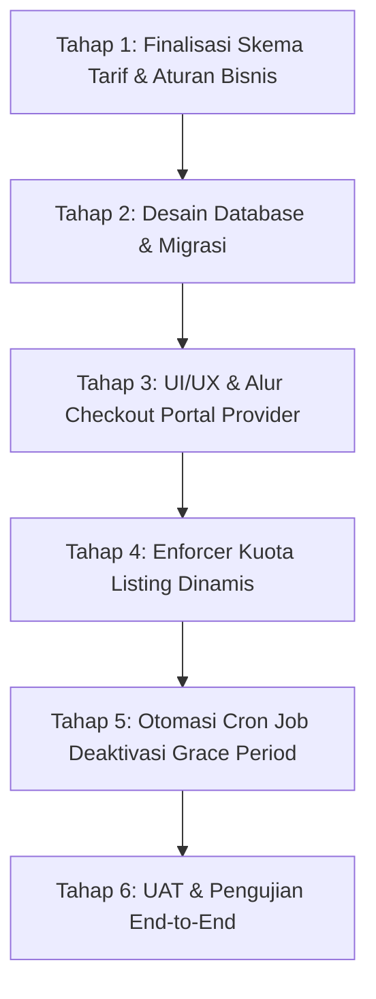

# Rencana Implementasi: Modul Billing & Subscription Provider (KosAja)

*Dokumen ini merupakan rangkuman hasil diskusi, analisis gap PRD, dan peta jalan (roadmap) pengembangan Modul Billing Provider KosAja.*

---

## 1. Latar Belakang & Analisis Masalah

### 1.1. Klausul PRD Blueprint
Pada dokumen [3. PRD_Blueprint_v0.1.md](3.%20PRD_Blueprint_v0.1.md), Bagian 29 (*Provider Monetization*), tercantum aturan:
> **FR-PM-004:**  
> *"Ketika Free Period berakhir akibat transaksi sewa pertama berhasil, sistem memberikan masa transisi (Grace Period 3 hari) bagi provider untuk memilih paket Listing Fee / Subscription sebelum sisa unit listing yang belum tersewa dinonaktifkan dari marketplace."*

### 1.2. Kondisi Riil Sistem Saat Ini
1. **Belum Ada Modul Billing Mandiri (*Self-Service*):** Di portal penyedia/provider, belum tersedia menu pemilihan paket, perpanjangan, maupun checkout pembayaran langganan/listing fee.
2. **Kapasitas Listing Bersifat Statis:** Sistem saat ini baru menerapkan *hard limit* gratis Starter sebanyak 3 iklan aktif pada [Listings.php](app/Controllers/Provider/Listings.php).
3. **Masa Transisi (Grace Period):** Sistem di [ProviderProfileModel.php](app/Models/ProviderProfileModel.php) sudah memajukan `free_period_end` menjadi `+3 hari` saat pembayaran sewa pertama lunas (FR-PM-002), namun **belum ada cron job** yang mengeksekusi penonaktifan unit jika 3 hari tersebut lewat karena belum ada sarana pembayaran bagi mitra.
4. **Catatan Scope MVP:** Pada [6. Implementation_Plan_v0.1.md](6.%20Implementation_Plan_v0.1.md), modul *Subscription Billing* awalnya ditandai ditunda ke Phase 2 pasca-MVP.

---

## 2. Arah Keputusan Strategis

Dari diskusi yang telah dilakukan, disepakati untuk mengambil:
> **"Opsi B: Implementasi Penuh Modul Billing"**  
> *Membangun modul paket langganan dan penagihan penyedia secara end-to-end sehingga platform siap memonetisasi mitra secara transparan, otomatis, dan mandiri.*

---

## 3. Roadmap Tahapan Pengembangan

### Tahap 1: Finalisasi Keputusan Bisnis & Kebijakan Tarif
*Tujuan: Mengunci model penagihan sebelum penulisan kode.*
- [ ] **Pilihan Model Tarif Utama:**
  - **Pilihan 1 (Direkomendasikan): Subscription Bulanan (PRD Bab 32 & Menu Admin SA-10)**  
    - *Starter / Gratis*: Kuota 3 unit (Rp0/bulan).
    - *Juragan Kos (Pro)*: Kuota 15 unit (Rp75.000/bulan).
    - *Bisnis Properti (Enterprise)*: Kuota 50 unit (Rp200.000/bulan).
  - **Pilihan 2: Listing Fee 15-Harian (PRD Bab 30)**  
    - Bayar per kuota slot aktif (misal 3 slot = Rp10.000/15 hari, 10 slot = Rp25.000/15 hari).
- [ ] **Aturan Penonaktifan saat Grace Period Habis:**
  - Menentukan apakah seluruh sisa unit yang belum tersewa dinonaktifkan, atau sistem mempertahankan 3 unit default tetap aktif dan hanya menonaktifkan unit ke-4 dst.

---

### Tahap 2: Desain Database & Skema Migrasi
*Prinsip: Sesuai [4. UX_Blueprint_v0.1.md](4.%20UX_Blueprint_v0.1.md), jangan mencampur tagihan provider dengan tagihan sewa tenant.*
- [ ] **Tabel `subscription_plans`**:
  - Kolom: `id`, `name`, `slug`, `price`, `billing_cycle` (`monthly`/`biweekly`), `listing_capacity`, `features` (JSON), `is_active`.
- [ ] **Tabel `provider_subscriptions`**:
  - Kolom: `id`, `provider_id`, `plan_id`, `start_date`, `end_date`, `grace_period_end`, `status` (`active`, `in_grace_period`, `expired`, `cancelled`), `capacity_limit`.
- [ ] **Tabel `provider_invoices` & `provider_payments`**:
  - Kolom invoice: `invoice_number`, `provider_id`, `plan_id`, `amount`, `status` (`pending`, `paid`, `expired`), `payment_method`, `snap_token`.
  - Kolom payment: `gateway_trx_id`, `payment_type`, `paid_at`.

---

### Tahap 3: Pengembangan UI/UX Portal Provider & Alur Checkout
- [ ] **Menu Baru di Sidebar Provider:**
  - Menu: **"Paket & Langganan"** (`/provider/subscription`).
- [ ] **Halaman Katalog & Status:**
  - Status paket aktif dan tanggal perpanjangan.
  - Banner countdown jika sedang dalam masa transisi Grace Period (contoh: *"Masa transisi tersisa 2 hari"*).
  - Kartu perbandingan paket (*Starter*, *Pro*, *Enterprise*) dengan tombol aksi "Pilih Paket" / "Upgrade".
  - Bar meter kapasitas terpakai (contoh: *Terpakai: 4 / Kuota: 15 Listing*).
- [ ] **Alur Pembayaran (Midtrans Integration):**
  - Mengintegrasikan Midtrans Snap popup untuk pembayaran paket secara instan (menggunakan alur payment yang sudah terpasang di KosAja).
  - Webhook handler untuk menangkap callback sukses dan memperpanjang masa aktif langganan secara otomatis.

---

### Tahap 4: Integrasi Kuota Dinamis pada Listing Iklan
- [ ] Mengubah batas statis `$maxFreeListings = 3` di [Listings.php](app/Controllers/Provider/Listings.php) menjadi kapasitas dinamis yang dibaca dari tabel `provider_subscriptions`.
- [ ] Mengupdate validasi pada fungsi `create()` dan `store()` listing.
- [ ] Menampilkan pesan kontekstual pada halaman listing: jika kuota penuh, sediakan tombol langsung menuju `/provider/subscription` (*CTA: Upgrade Kuota*).

---

### Tahap 5: Otomasi Latar Belakang (*Cron Job & Expiry Engine*)
- [ ] **Spark CLI Command:**
  - Membuat perintah `php spark provider:process-grace-period`.
- [ ] **Logika Scheduler:**
  - Mendeteksi provider yang masa transisinya kedaluwarsa (`free_period_end < today`) tanpa paket berbayar aktif.
  - Mengubah status publikasi unit yang melebihi kuota menjadi `publication_status = 'inactive'`.
  - Mencatat aksi ke `audit_logs` (`LISTING_AUTO_DEACTIVATED_BILLING_EXPIRED`).
  - Mengirim notifikasi dashboard kepada provider bahwa listing telah dinonaktifkan sementara dan dapat dipulihkan kapan saja setelah memilih paket.

---

### Tahap 6: Pengujian & Validasi End-to-End
- [ ] Skenario Sukses: Transaksi sewa pertama lunas -> Trigger Grace Period 3 hari -> Notifikasi muncul -> Provider memilih paket -> Bayar via Midtrans -> Kapasitas bertambah -> Semua unit tetap aktif.
- [ ] Skenario Jatuh Tempo: Grace Period habis tanpa pembelian paket -> Cron job menonaktifkan unit berlebih -> Unit tersewa tetap aman -> Begitu provider membeli paket, unit dapat diaktifkan kembali.

---

## 4. Status Terkini & Langkah Lanjutan

- **Status:** Perencanaan selesai, belum ada kode/script yang diubah.
- **Titik Lanjutan:** Saat sesi berikutnya dibuka, kita langsung mulai dari **Tahap 1 (Konfirmasi skema tarif dan aturan de-aktivasi)**, lalu melanjutkan ke pembuatan migrasi database.
- **ID Sesi Percakapan:** `7d6e8e2c-7aaa-461b-acb4-1fca65f70db1`
